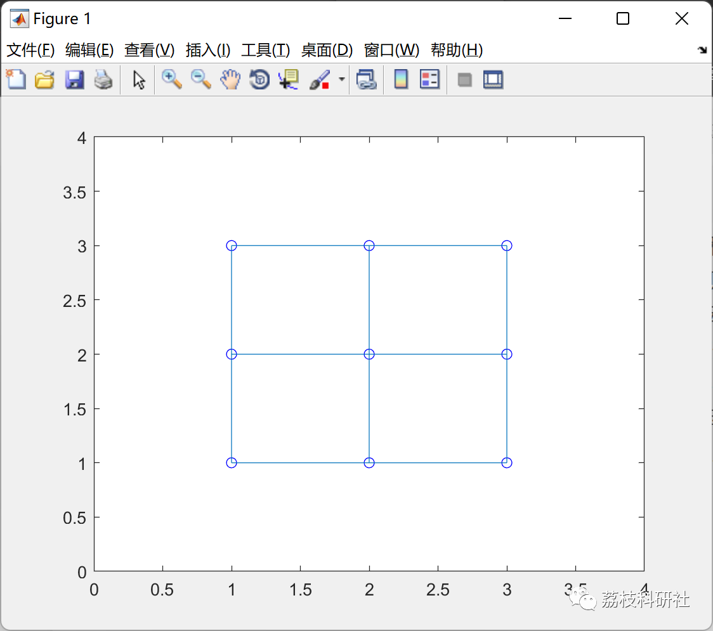
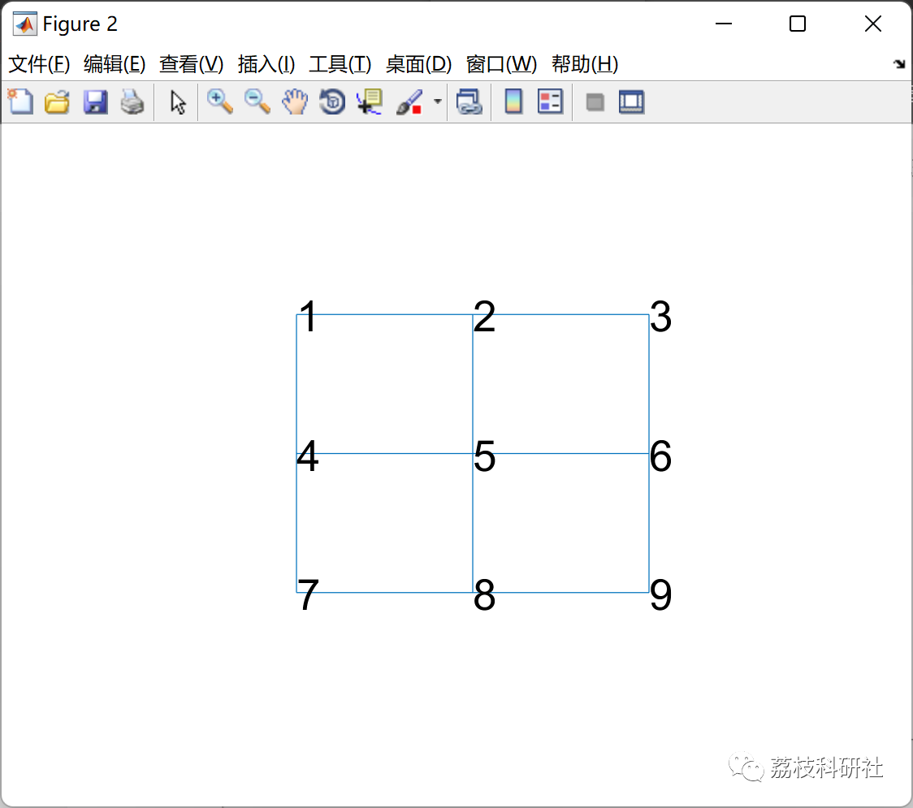
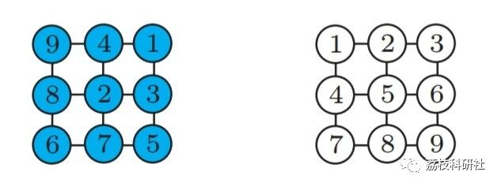

# Strategy for Multi-Robot Path Planning Based on A* Algorithm (Matlab Code Implementation)

💥💥💥💞💞💞💞 Welcome to this blog❤️❤️❤️💥💥💥
🏆 Bloggers' Advantage: 🌞🌞🌞 The content of the blog strives to be rigorous in thought and clear in logic, for the convenience of readers.
⛳️ Mantra: The journey of a hundred miles is half done in the last ninety.
Litchi Research Society
Code Collection: Power System, Intelligent Algorithms and Applications, Neural Network Prediction, Path Planning, Optimized Scheduling, Workshop Scheduling, Image Processing, Signal Processing...
🎁Column Directory Link:
🌈🌈🌈🌟🌟🌟🛫🛫🛫🛫🛫🛫🛫🛫🛫🛫🛫🛫🛫🛫🛫🛫🛫🛫🛫🛫🛫🛫🛫🛫🛫🛫🛫🛫🛫🛫🛫🛫🛫🛫🛫🛫🛫🛫🛫🛫🛫🛫🛫🛫🛫🛫🛫🛫🛫🛫🛫🛫🛫🛫🛫🛫🛫🛫🛫🛫🛫🛫🛫🛫🛫🛫🛫🛫🛫🛫🛫🛫🛫🛫🛫🛫🛫🛫🛫🛫🛫🛫🛫🛫🛫🛫🛫🛫🛫🛫🛫🛫🛫🛫🛫🛫🛫🛫🛫🛫🛫🛫🛫🛫🛫🛫🛫🛫🛫🛫🛫🛫🛫🛫🛫🛫🛫🛫🛫🛫🛫🛫🛫🛫🛫🛫🛫🛫🛫🛫🛫🛫🛫🛫🛫🛫🛫🛫🛫🛫🛫🛫🛫🛫🛫🛫🛫🛫🛫🛫🛫🛫🛫🛫🛫🛫🛫🛫🛫🛫🛫🛫🛫🛫🛫🛫🛫🛫🛫🛫🛫🛫🛫🛫🛫🛫🛫🛫🛫🛫🛫🛫🛫🛫🛫🛫🛫🛫🛫🛫🛫🛫🛫🛫🛫🛫🛫🛫🛫🛫🛫🛫🛫🛫🛫🛫🛫🛫🛫🛫🛫🛫🛫🛫🛫🛫🛫🛫🛫🛫🛫🛫🛫🛫🛫🛫🛫🛫🛫🛫🛫🛫🛫🛫🛫🛫🛫🛫🛫🛫🛫🛫🛫🛫🛫🛫🛫🛫🛫🛫🛫🛫🛫🛫🛫🛫
💥1 Overview
As society's demand for mobile robots grows, the ability of intelligent mobile robots to navigate autonomously and plan paths in environments where some or all surroundings are unknown has become a research hotspot in recent years. The main research content includes the real-time map construction of the robot's surrounding environment and its own simultaneous localization and mapping (SLAM), as well as path planning methods based on the constructed map. The A* algorithm, as a global static path planning search algorithm, has advantages such as robustness and quick response. However, due to limitations in the algorithm's principles, it results in more convoluted planned paths and exponentially increasing search costs as the environment expands.
📚2 A* Algorithm
A* algorithm as a global static path planning search algorithm, it has the advantages of good robustness and fast response. However, traditional A* algorithms have problems such as path non-smoothness and low search efficiency when solving path planning problems, and are only suitable for global static environments [5]. This paper proposes a multiple A* algorithm based on dynamic environments: optimize global path nodes, introduce deletion redundant node criterion and addition node criterion to make the global path smoother and more in line with robot kinematics; combine the idea of rolling window method, carry out local path planning within each rolling window, first determine the local sub-target area according to the previous step's node information, then introduce obstacle avoidance control strategy for real-time obstacle avoidance within the local sub-target area. This paper combines the moving characteristics of omnidirectional mobile chassis and wheeled crawler chassis, designs path planning algorithms based on shortest travel path and shortest time consumption indicators respectively on the basis of improved A* algorithm.
🎉3 Run results  
👨‍💻4 References  
[1] Hua Hong. Research on path planning method of autonomous mobile robot based on improved A~* algorithm [D]. Nanjing University of Technology, 2021. DOI:10.27241/d.cnki.gnjgu.2021.001065.  
[2] Liu Chenxi. Path planning research of humanoid robot based on improved A* algorithm [D]. Beijing University of Architecture and Technology, 2018.  
[3] Yu Jingin, Steven M. LaValle. "Optimal multirobot path planning on graphs: Complete algorithms and effective heuristics." IEEE Transactions on Robotics 32.5(2016): 1163-1177.  
📚5 Matlab code implementation  
Click the article bottom left [Read More]

## Images

<!-- PAYMENT_BLOCK -->

## Get this dataset

- Payment link (Stripe): [Buy now](https://buy.stripe.com/3cs8yP7sY87d0vu9AB)
- Payment QR code: 

<!-- /PAYMENT_BLOCK -->
